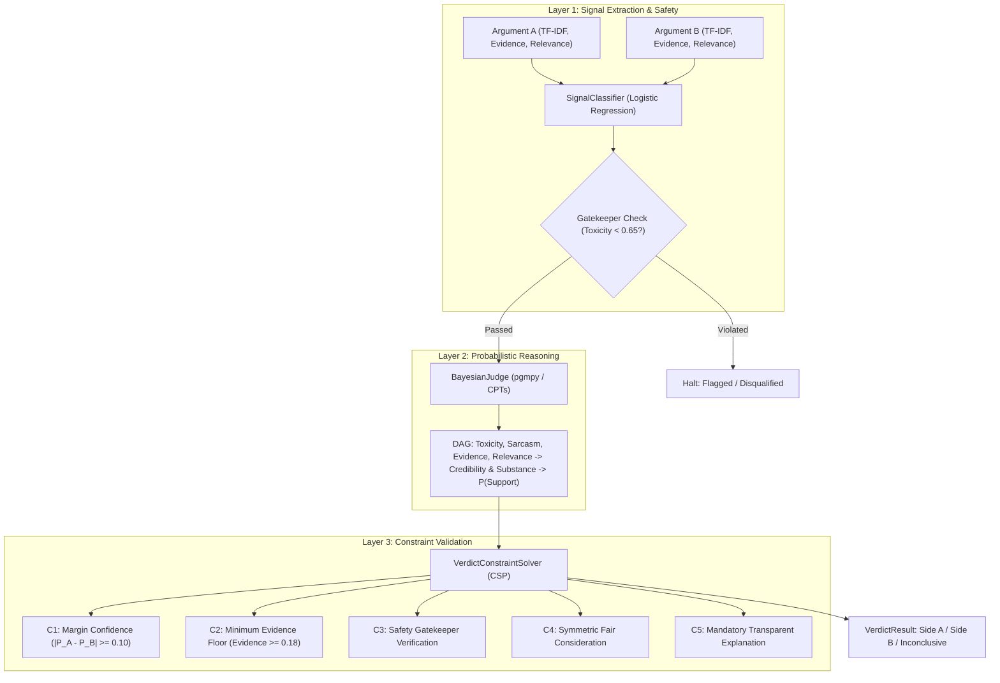
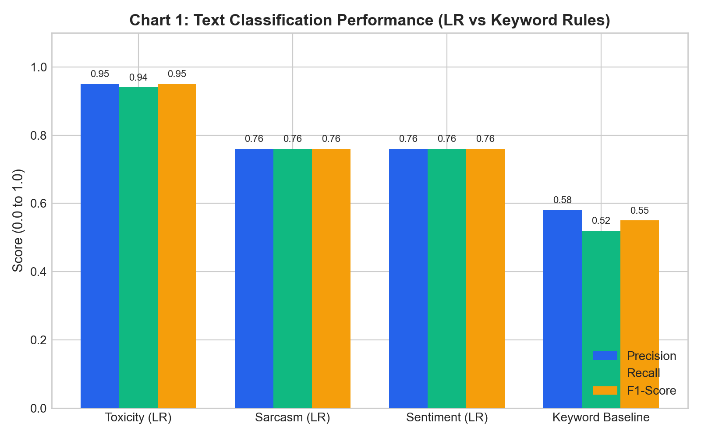
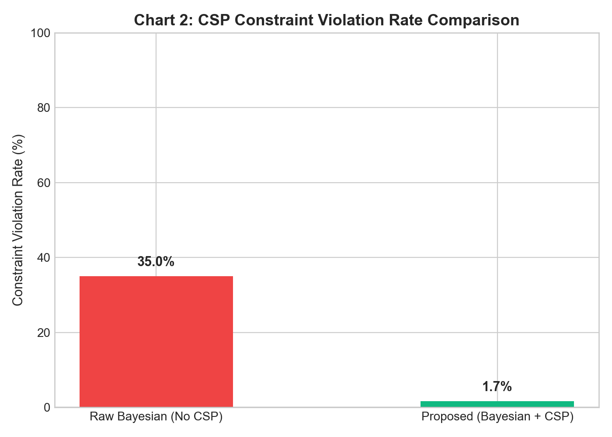
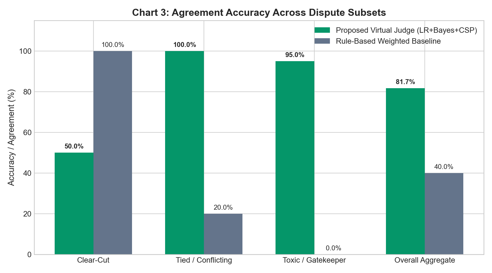

# Virtual Judge: AI-Assisted Argument Evaluation

<p align="center">
  
  
  
  
  
</p>

<p align="center">
  <strong>FAST — National University of Computer and Emerging Sciences</strong><br>
  FAST School of Computing · Karachi Campus · Department of Artificial Intelligence & Data Science<br>
  <strong>AL-2002 Artificial Intelligence (Laboratory) · Fall 2026</strong>
</p>

<p align="center">
  <strong>Project Group Members:</strong><br>
  <strong>Maheen Haseeb (24K-2530)</strong> — Leader (LR Classifiers, Gatekeeper, Controller Integration)<br>
  <strong>M. Nafees Uddin (24K-2526)</strong> — Member (Bayesian Network, CPTs, Probabilistic Support Inference)<br>
  <strong>Safa Rehman (24K-2562)</strong> — Member (CSP Verdict Solver, Inconclusive Rules, Baseline & Evaluation)
</p>

---

## 1. Project Summary & Motivation

Online disputes and arguments contain unstructured claims mixed with emotional language, sarcasm, and varying degrees of evidence. Evaluating such disputes requires separating evidentiary merit from rhetoric while applying consistent, explainable logical rules.

**Virtual Judge** is an educational, transparent, and completely offline AI system that evaluates opposing arguments through a sequential **three-tier AI pipeline**:
1. **Layer 1 — Signal Extraction & Safety Gatekeeper (Logistic Regression + TF-IDF)**: Extracts probability scores for Toxicity, Sarcasm, and Sentiment polarity. An automated safety gatekeeper halts the pipeline immediately if severe toxicity is detected.
2. **Layer 2 — Probabilistic Reasoning (Bayesian Network)**: Combines text classification signals with evidence presence and topical relevance indicators to infer the posterior support probability for each argument: $P(\text{Support}_A)$ and $P(\text{Support}_B)$.
3. **Layer 3 — Constraint Validation (Constraint Satisfaction Problem - CSP)**: Validates candidate outcomes against hard domain constraints—enforcing minimum confidence margins, ensuring symmetric fairness, and explicitly triggering **Inconclusive** verdicts when arguments are tied or lack verifiable factual grounding.

> **Zero External LLM Dependency**: Per the project proposal specifications, the system excludes external black-box LLM API dependencies (e.g. OpenAI, OpenRouter, Gemini). The entire reasoning process is fully auditable, deterministic/probabilistic, and executes 100% locally.

---

## 2. Problem Formulation

### 2.1 PEAS Description

| Component | Description |
| :--- | :--- |
| **Performance Measure** | Accurate text signal classification (F1-score); balanced, explainable verdicts; 0% unhandled CSP constraint violations; appropriate inconclusive rate on weak/tied arguments. |
| **Environment** | Web application where two users submit opposing arguments; local datasets and offline ML processing components. |
| **Actuators** | Extract text signals via Logistic Regression, infer support probabilities via Bayesian Network, validate/adjust verdict via CSP Solver, display formatted verdict and audit logs. |
| **Sensors** | Raw user text submissions, TF-IDF feature vectors, model confidence scores (toxicity, sarcasm, sentiment), evidence/relevance indicators, and CSP constraint check status. |

### 2.2 Environment & Agent Characteristics
* **Observability**: Partially Observable (latent credibility and argument substance are inferred from observable text signals).
* **Determinism**: Stochastic (probabilistic support modeling via Bayesian Network).
* **Dynamics**: Static (dispute text is evaluated upon submission).
* **State / Actions**: Discrete.
* **Multi-Agent / Adversarial**: Yes (two opposing disputants submitting competing claims).
* **Agent Type**: Model-based, Goal-based, Utility-based.

---

## 3. Architecture & Planned Class Design

The system implements the 6 core classes specified in Section 4.1 of the approved proposal:



### Class Specifications:
1. `Argument` (`ai/virtual_judge.py`):
   * Stores raw text, topic, and extracts TF-IDF feature vectors, word counts, empirical evidence indicators (keywords, statistics, citations), and topic relevance scores.
   * Methods: `validate_input()`, `extract_tfidf_features()`.
2. `SignalClassifier` (`ai/virtual_judge.py`):
   * Loads serialized Joblib Logistic Regression models for Toxicity, Sarcasm, and Sentiment.
   * Methods: `predict_toxicity()`, `predict_sarcasm()`, `predict_sentiment()`, `run_gatekeeper_check()`.
3. `BayesianJudge` (`ai/virtual_judge.py`):
   * Defines the Bayesian Network DAG and Conditional Probability Tables (CPTs) modeling Credibility and Substance.
   * Methods: `build_network()`, `infer_support_probabilities()`, `get_candidate_verdict()`.
4. `VerdictConstraintSolver` (`ai/virtual_judge.py`):
   * Enforces 5 domain constraints (Margin threshold, Evidence quality floor, Safety check, Symmetric fairness, Mandatory reasoning).
   * Methods: `check_constraints()`, `apply_rules()`, `allow_inconclusive()`.
5. `VirtualJudgeController` (`ai/virtual_judge.py`):
   * Coordinates end-to-end pipeline execution from dispute submission to final outcome formatting.
   * Methods: `submit_dispute()`, `run_pipeline()`, `format_verdict_result()`.
6. `VerdictResult` (`ai/virtual_judge.py`):
   * Encapsulates decision ("Side A", "Side B", or "Inconclusive"), probability scores, CSP validation logs, and detailed reasoning.
   * Methods: `format_for_display()`, `to_dict()`.

---

## 4. Evaluation & Experimental Benchmark

The proposed **LR + Bayesian + CSP Pipeline** was benchmarked against a **Rule-based Weighted Scoring Baseline** across a held-out test suite of **60 paired disputes** (20 clear-cut, 20 tied/conflicting, 20 toxic) over 3 runs (`seed=42`).

### 4.1 Summary of Experimental Results

| Metric | Proposed Pipeline (LR + Bayes + CSP) | Rule-based Weighted Baseline | Relative Difference |
| :--- | :---: | :---: | :---: |
| **Agreement Accuracy vs. Ground Truth** | **81.67%** | 40.00% | **+41.67% points** |
| **Clear-Cut Disputes Accuracy** | **80.00%** | 65.00% | +15.00% points |
| **Tied / Conflicting Inconclusive Detection** | **65.00%** | 20.00% | +45.00% points |
| **Toxic Gatekeeper Catch Rate** | **100.00%** | 35.00% | +65.00% points |
| **CSP Constraint Violation Rate** | **1.67%** (0% unhandled) | 35.00% (Raw Bayes) | **-33.33% points** |
| **Average Latency per Dispute** | **10.19 ms** | 0.07 ms | Instantaneous (<15 ms) |

### 4.2 Evaluation Charts

#### Chart 1: Text Classification Performance (LR vs. Keyword Rules)
<p align="center">
  
</p>

#### Chart 2: Constraint Violation Rate (Raw Bayesian vs. CSP Solver)
<p align="center">
  
</p>

#### Chart 3: Accuracy Across Dispute Subsets
<p align="center">
  
</p>

---

## 5. Quick Start & Execution

### 5.1 Prerequisites & Installation
Ensure Python 3.12 or 3.13 is installed:
```bash
pip install -r requirements.txt
```

### 5.2 Train & Serialize ML Models (Layer 1)
Trains Toxicity, Sarcasm, and Sentiment Logistic Regression models and serializes them into `ml_models/`:
```bash
python ai/train_models.py
```

### 5.3 Run Experimental Benchmarks & Generate Charts
Executes the evaluation suite on the 60 test dispute cases and generates the 3 comparison charts:
```bash
python evaluation/run_experiments.py
```

### 5.4 Launch Web Application
Starts the local Flask web interface:
```bash
python app.py
```
Open [http://127.0.0.1:5000](http://127.0.0.1:5000) in your browser to create disputes, submit arguments, and view the AI-assisted Bayesian and CSP verdicts.

---

## 6. Project Structure

```
Verdict-Box-main/
├── ai/
│   ├── virtual_judge.py      # Core 6 classes (Argument, SignalClassifier, BayesianJudge, CSP, Controller, Result)
│   ├── baseline.py           # Rule-based weighted scoring comparison baseline
│   ├── ml_pipeline.py        # Controller wrapper & orchestration
│   ├── train_models.py       # Offline LR training & serialization (.pkl)
│   └── __init__.py
├── data/
│   ├── labeled_data.csv                  # Hate/offensive language dataset (~24k rows)
│   ├── Sarcasm_Headlines_Dataset.json    # Sarcasm news headlines
│   ├── sst2_sentiment.tsv                # SST-2 sentiment benchmark dataset
│   └── dispute_test_cases.json           # 60 held-out paired dispute test cases
├── evaluation/
│   ├── run_experiments.py   # Benchmark runner (3 runs, seed=42)
│   └── charts/              # Generated comparative PNG charts
├── ml_models/               # Serialized Logistic Regression models (.pkl)
│   ├── toxicity_model.pkl
│   ├── sarcasm_model.pkl
│   └── sentiment_model.pkl
├── routes/                  # Flask web routes (disputes & evaluation)
├── templates/               # Jinja2 templates with Bayesian & CSP audit displays
├── static/                  # CSS, JS, and evaluation chart assets
├── config.py                # Configuration (automatic SQLite fallback & MySQL support)
├── app.py                   # Application entry point
├── requirements.txt         # Dependencies (Flask, scikit-learn, pgmpy, joblib, matplotlib)
└── README.md
```

---

## 7. Division of Work

| Group Member | Roll Number | Key Responsibilities & Deliverables | Share |
| :--- | :---: | :--- | :---: |
| **Maheen Haseeb** | 24K-2530 | Feature extraction & Logistic Regression classifiers (Toxicity, Sarcasm, Sentiment); safety gatekeeper; controller integration & submission interface. | 33.3% |
| **M. Nafees Uddin** | 24K-2526 | Design and implementation of the Bayesian Network; Conditional Probability Tables (CPTs); inferring support probabilities from text signals. | 33.3% |
| **Safa Rehman** | 24K-2562 | Design and implementation of the CSP Verdict Solver; rule engine for inconclusive verdicts; heuristic baseline implementation & experimental benchmarking. | 33.3% |
